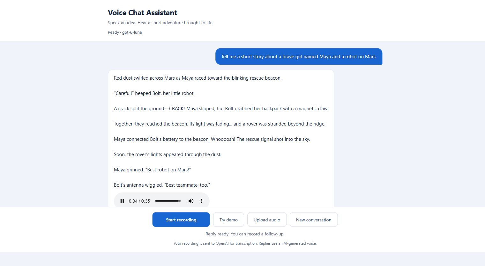
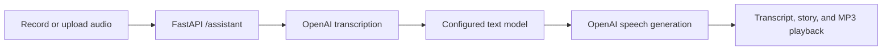

# AI Voice Assistant

**Live demo:** [ai-voice-assistant-steel.vercel.app](https://ai-voice-assistant-steel.vercel.app)

A voice-driven adventure storyteller built with **FastAPI, vanilla JavaScript, and OpenAI**. Record a story idea, upload audio, or try the included demo. The app transcribes the recording, creates a short story based on your words, and reads it back with an AI-generated voice.



## Features

- Browser microphone recording with start/stop controls and a 60-second recording limit.
- Audio upload and a bundled synthetic demo for testing without a microphone.
- Speech-to-text, contextual story generation, and spoken MP3 replies.
- Follow-up conversations with recent message context and a fresh-session reset.
- Visible playback controls when autoplay is unavailable.
- Responsive interface with loading states and actionable microphone/API errors.
- Server-side credentials, upload validation, and bounded in-memory sessions.

The default personality is a kid-friendly, cinematic adventure storyteller. Edit `prompt.py` to change the assistant's behavior.

## How it works



The browser and API are served from one origin. The backend uses asynchronous OpenAI calls and sends the transcribed user message plus recent conversation context to the Responses API. Credentials stay on the server.

## Requirements

- Python **3.14** for the environment used in verification.
- An OpenAI API key with access and quota for the configured text, transcription, and speech models.
- A modern browser supporting microphone capture and `MediaRecorder`.
- Node.js **22 or later** to run the frontend regression checks; Node is not required to run the app.

Microphone capture works on localhost or HTTPS. OpenAI requests need an internet connection and incur API usage.

## Quick start

### Windows / PowerShell

```powershell
git clone https://github.com/harshgavandit/ai-voice-assistant.git
cd ai-voice-assistant
python -m venv .venv
.\.venv\Scripts\python.exe -m pip install -r requirements.txt
Copy-Item .env.example .env
```

Edit `.env` locally and replace `your-api-key-here` with your OpenAI API key. Then start the server:

```powershell
.\.venv\Scripts\python.exe -m uvicorn main:app --host 127.0.0.1 --port 8010
```

Open **http://127.0.0.1:8010/**. Stop the foreground server with Ctrl+C. You can also use `./run.ps1` after setup; it defaults to port 8010 and accepts `-Port 8011` if you need another port.

### macOS / Linux

```bash
git clone https://github.com/harshgavandit/ai-voice-assistant.git
cd ai-voice-assistant
python3 -m venv .venv
.venv/bin/python -m pip install -r requirements.txt
cp .env.example .env
# Edit .env and add your OpenAI API key before starting.
.venv/bin/python -m uvicorn main:app --host 127.0.0.1 --port 8010
```

The app was verified on Windows with Python 3.14. The macOS/Linux commands follow the same Python setup; those platforms have not been tested for this project.

## Configuration

| Variable | Purpose | Default |
| --- | --- | --- |
| `OPENAI_API_KEY` | Server-side OpenAI credential | Required |
| `OPEN_AI_API_KEY` | Accepted legacy spelling | Used if the standard variable is absent |
| `OPENAI_MODEL` | Text reply model | `gpt-4o-mini` in code; `.env.example` selects `gpt-6-luna` |
| `OPENAI_TRANSCRIPTION_MODEL` | Speech-to-text model | `whisper-1` |
| `OPENAI_TTS_MODEL` | Speech generation model | `gpt-4o-mini-tts` |
| `OPENAI_TTS_VOICE` | Speech voice | `onyx` |

The server loads `.env` from the project directory. Existing process environment variables take precedence over `.env`. Restart after configuration changes. The text model and speech models have separate access requirements.

Never commit your `.env`. The repository includes a placeholder-only `.env.example`; `.env`, virtual environments, caches, and runtime logs are ignored.

## Using the assistant

1. Click **Start recording** and allow microphone access in your browser.
2. Speak your idea, then click **Stop & send**. For example: “Tell me a short story about a brave girl named Maya and a robot on Mars.”
3. Read the transcript and story, and listen to the generated reply.
4. Record a follow-up to continue the conversation, or click **New conversation** to start fresh.

**Try demo** submits the bundled synthetic recording through the same real OpenAI pipeline. **Upload audio** accepts WebM, WAV, MP3, MP4, M4A, OGG, FLAC, MPEG, and MPGA files. Uploaded audio must be non-empty. The hosted Vercel version accepts files up to 4 MB; local runs accept up to 24 MB. The browser reads the active limit from the server.

Recordings are sent to OpenAI for transcription. Replies use an AI-generated voice. The interface displays this disclosure.

## Project structure

```text
ai-voice-assistant/
├── main.py                 # FastAPI routes, OpenAI pipeline, session context
├── prompt.py               # Story personality and content instructions
├── index.html              # Responsive interface
├── script.js               # Recording, requests, playback, and UI state
├── assets/demo-prompt.wav  # Synthetic spoken demo input
├── tests/
│   ├── test_assistant.py    # Backend regressions with mocked OpenAI
│   └── test_frontend.mjs    # Frontend checks with browser API doubles
├── docs/images/            # Screenshots of the verified synthetic demo
├── .env.example            # Configuration template without credentials
├── requirements.txt        # Pinned application dependencies
├── requirements-dev.txt    # Test dependencies
├── run.ps1                 # PowerShell launcher
├── VERIFICATION.md         # Evidence record and verification boundaries
└── Documentation.pdf       # Original implementation documentation
```

`Documentation.pdf` describes the initial implementation and older defaults. This README describes the current code.

## API

| Method | Route | Purpose |
| --- | --- | --- |
| GET | `/` | Browser interface |
| GET | `/script.js` | Frontend JavaScript |
| GET | `/demo.wav` | Synthetic demo recording |
| GET | `/health` | Configuration readiness and model names |
| POST | `/assistant` | Audio-to-audio interaction |

`POST /assistant` accepts multipart fields `file` and `session_id` (default: `default`). The browser generates a unique session identifier for each conversation. A successful response includes:

```json
{
  "transcript": "The transcribed user request",
  "response": "The generated story",
  "audio_base64": "Base64-encoded MP3 bytes",
  "audio_mime_type": "audio/mpeg"
}
```

`/health` checks configuration readiness without making an OpenAI request; it does not prove available quota or model access. Only explicit static files are served, so `/.env` is inaccessible.

## Vercel deployment

The live app is hosted at **https://ai-voice-assistant-steel.vercel.app** in the `ai-voice-assistant` Vercel project, linked to this GitHub repository.

- Vercel detects the `app` exported from `main.py` as FastAPI.
- `.python-version` selects Python 3.14.
- `vercel.json` sets a 240-second function limit for the three sequential OpenAI stages.
- `.vercelignore` excludes local environment files, virtual environments, caches, tests, and documentation from the deployed bundle.
- The OpenAI key is a sensitive production environment variable. The key is never included in the browser JavaScript or committed configuration.
- The app uses a 4 MB audio upload limit when `VERCEL` is set, leaving room below the platform's request payload limit. A non-JSON platform failure also produces a readable browser error.

To deploy your own copy, import the GitHub repository into Vercel with the FastAPI preset. Add the variables listed under Configuration to the production environment, then deploy. Select **Sensitive** for `OPENAI_API_KEY`. Model settings must match access available to your API project. Do not upload `.env` as an asset.

On serverless hosting, conversation context is temporary and specific to a running instance. It may reset when instances restart or requests reach another instance; durable shared history is not implemented. Each recording, including **Try demo**, makes real requests against the configured OpenAI key and consumes its API quota.

## Tests

Backend tests mock OpenAI and make no paid API requests. The frontend checks use browser API doubles and do not require a running server.

```powershell
.\.venv\Scripts\python.exe -m pip install -r requirements-dev.txt
.\.venv\Scripts\python.exe -m pytest tests -q
node tests/test_frontend.mjs
node --check script.js
.\.venv\Scripts\python.exe -m pip check
```

On macOS/Linux, replace `.\.venv\Scripts\python.exe` with `.venv/bin/python`.

The suite covers transcript forwarding, configured model use, response fields, follow-up context and session isolation, file validation, provider errors, failed speech rollback, recording cleanup, denied microphone permission, playback fallback, and conversation reset.

## Verification

The October 13, 2026 live browser test completed:

- `whisper-1` transcription of the bundled request about Maya and a robot on Mars.
- A matching story generated by the configured `gpt-6-luna` model.
- `gpt-4o-mini-tts` speech with `onyx`, loaded and played to completion in Chrome: **35.352 seconds**, with no media error.
- Desktop and mobile layout inspection; at a 390-pixel viewport the document width was also 390 pixels.

Before the October 14, 2026 repository publication, **17 backend tests and 7 frontend checks** were rerun, along with JavaScript syntax, Python compilation, and dependency consistency checks. See [VERIFICATION.md](VERIFICATION.md) for the full record.

Physical microphone capture and audible speaker output were not tested in the live demo. Recording behavior was verified with browser API doubles. Detailed runtime logs and generated JSON evidence stay local; the repository screenshots show only the synthetic prompt and generated story.

## Troubleshooting

| Symptom | Next step |
| --- | --- |
| Microphone permission denied | Allow microphone access in your browser or upload an audio file |
| No microphone found | Connect a microphone or use **Try demo** |
| Reply text appears but no sound | Press Play on the reply's audio control and check device volume |
| API key rejected | Check the local key configuration and restart the server |
| Quota exhausted / rate limited | Check OpenAI API billing and project limits; wait before retrying a rate-limited request |
| Configured model unavailable | Check model access for the API key's project and the relevant environment variable |
| Port already in use | Start on another free port and open that address |

## Scope and limitations

Local runs bind to `127.0.0.1`; the Vercel deployment serves the same app over public HTTPS. The app has no public-user authentication, application-level rate limiter, or durable conversation storage. Recent context is held in process memory, limited to 12 messages per session and 100 sessions, with a 30-minute inactivity expiry checked on subsequent requests. Restarting clears context; use a single worker for consistent conversation state.

Redis persistence is not implemented. The public URL is a demonstration deployment; a service intended for ongoing public traffic would need authentication, request limits, and shared storage. The hosted HTTP and real OpenAI pipeline checks from October 20 are recorded in `VERIFICATION.md`. Browser automation was unavailable for that deployment check, so hosted browser playback and physical microphone/speaker output are not claimed.
